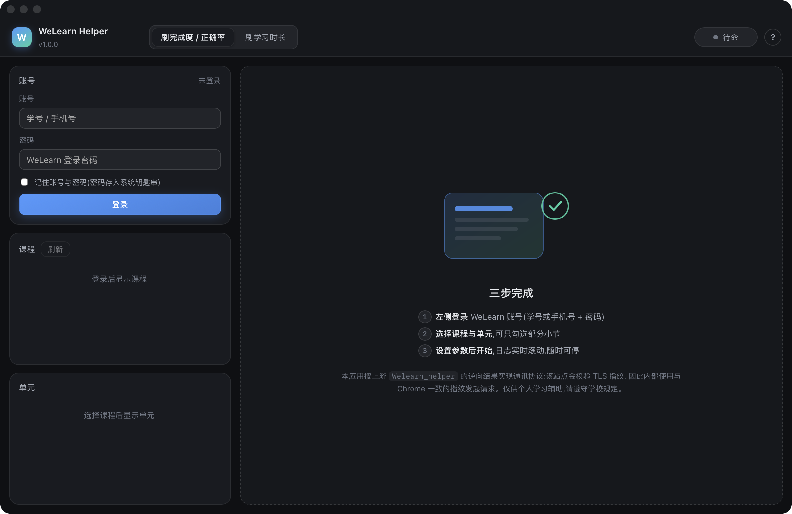

# WeLearn Helper for macOS

把 [YZBRH/Welearn_helper](https://github.com/YZBRH/Welearn_helper) 的协议逆向结果重写成 **macOS 原生应用**:
双击打开一个真正的 Mac 窗口(WKWebView),而不是 Windows 批处理 + 浏览器标签页。

## 原作者与来源(请先读这一段)

> **本仓库不是原创协议实现。** 登录密文、OIDC 授权流程、SCO 提交接口等全部协议细节,
> 都来自下列作者的逆向工作。本仓库只做 macOS 侧重写与若干缺陷修正。

| 项 | 内容 |
| --- | --- |
| 原项目 | **WELearnToSleep** |
| **原作者** | **[Avenshy](https://github.com/Avenshy)** |
| 早期共同作者 | **[SSmJaE](https://github.com/SSmJaE)** |
| 现维护项目 | [YZBRH/Welearn_helper](https://github.com/YZBRH/Welearn_helper) |
| 现维护者 | **[YZBRH](https://github.com/YZBRH)**、**[lxbsdsg](https://github.com/lxbsdsg)** |
| 许可证 | **GNU GPLv3**(与上游一致,见 [LICENSE](LICENSE)) |

修改说明了什么、哪些代码来自上游、哪些是本仓库新增,统一写在 [NOTICE.md](NOTICE.md)。
按 GPLv3 要求:再分发或二次修改必须同样开源,并保留上述署名。

**免费、开源,禁止售卖。** 仅供个人学习辅助,请遵守所在学校的使用规定,不要用于刷分等违规用途。



---

## 一、为什么不是"直接跑起来"

上游是纯 Python + Flask,表面上 `python web_gui.py` 在任何平台都能跑。真正的坑只有一个,但足够致命:

| 尝试方式 | 结果 |
| --- | --- |
| `requests` / `curl` 访问 `welearn.sflep.com` | **HTTP 405**,空响应体 |
| `tls_client`(chrome_120 指纹)访问 | **HTTP 302**,正常拿到登录跳转 |

站点前置的 WAF 会校验 **TLS 指纹(JA3)+ Header 顺序**,不是校验 UA 字符串。所以:

* 用 Swift `URLSession`、Go `net/http`、Python `requests` 原生重写,都会被打回 405;
* 唯一省事且可靠的做法是继续背着那个 Go/uTLS 编译的 `tls_client` 共享库。

结论:macOS 版保留 Python 协议层(与上游逐字节一致),把 **外壳换成原生窗口**,
并补齐 macOS 该有的东西(钥匙串、Application Support、`.app` 打包、`.command` 启动、深浅色界面)。

---

## 二、逆向分析:这套协议到底在做什么

### 1. 登录密码不是明文,也不是标准加密

网页里 `common.js` 的 `generateCipherText()`:

```js
let T0 = Date.now();
let P  = new TextEncoder().encode(password);      // UTF-8 字节
let V  = (T0 >> 16) & 0xFF;
for (let i = 0; i < P.length; i++) V ^= P[i];     // 时间戳高位异或密码每个字节
let remainder = V % 100;
let T1 = Math.floor(T0 / 100) * 100 + remainder;  // 把毫秒"截到百位"再接上校验值
let P1 = hex(P);                                  // 密码转十六进制字符串
let E  = btoa(T1 + '*' + P1);                     // base64("时间戳*密码hex")
```

提交时 `pwd = E`,`ts = T1`。也就是说服务端拿到的永远是 `base64("时间戳*十六进制密码")`,
密码本身只做了 hex 编码(等价于明文),`T1 % 100` 才是真正的校验位。

> ⚠️ 上游 Python 版写成 `int((T0 / 100) * 100 + remainder)`,浮点除法保留了百位以下的部分,
> 导致 `T1 % 100 != 校验值`,与真实浏览器不一致。macOS 版改为 `(t0 // 100) * 100 + remainder`,
> 并用 Node 跑同一份 JS、在固定时间戳下逐字节比对过(见 `tests/test_core.py::TestCipher`)。

### 2. 登录是 OIDC 授权码 + PKCE

```
GET  /user/prelogin.aspx?loginret=...
     → 302 Location: https://sso.sflep.com/idsvr/connect/authorize?...&code_challenge=XXX&state=YYY
        (从 Location 里取出 code_challenge / state)

POST https://sso.sflep.com/idsvr/account/login
     rturl=/connect/authorize/callback?client_id=welearn_web&redirect_uri=...welearn.sflep.com/signin-sflep
           &response_type=code&scope=openid profile email phone address
           &code_challenge=XXX&code_challenge_method=S256&state=YYY
     account=<账号>&pwd=<上文的 E>&ts=<T1>
     → {"code": 0|1|-1, "data": "/connect/authorize/callback?..."}

逐跳跟随 data 指定的重定向链(手动跟随,每跳都带 Cookie)→ Cookie 生效
```

* `code = 1` → 账号或密码错误;`code = -1` → 服务端要求重试(带随机延迟重试,上限 6 次);`code = 0` → 成功。

### 3. 课程 / 单元 / 小节

| 用途 | 请求 |
| --- | --- |
| 课程列表 | `GET /ajax/authCourse.aspx?action=gmc` → `clist[]`(`cid` / `name` / `per` 完成度) |
| uid / classid | `GET /student/course_info.aspx?cid=<cid>`,从 HTML 里抠 `"uid":..,` 与 `"classid":".."` |
| 单元列表 | `GET /ajax/StudyStat.aspx?action=courseunits&cid&uid` → `info[]`(`unitname`/`name`/`visible`) |
| 小节列表 | `GET /ajax/StudyStat.aspx?action=scoLeaves&cid&uid&unitidx&classid` → `info[]`(`location`/`iscomplete`/`isvisible`/`id`) |

注意 `unitidx` 是 **0-based**,界面上的单元编号是 1-based,两边差一,是错位 bug 的高发区。

### 4. 刷完成度 / 正确率:两个接口一起写

`POST /Ajax/SCO.aspx`,对每个小节依次发三次:

1. `action=startsco160928` —— 开启一次 SCO 会话;
2. `action=setscoinfo` —— 提交一整段 cmi JSON,
   `completion_status=completed`、`progress_measure=1`、`score.scaled=<正确率>`、`success_status=unknown`;
3. `action=savescoinfo160928` —— 再提交一次进度汇总:
   `progress=100`、`crate=<正确率>`、`cstatus=completed`、`status=unknown`、`trycount=0`。

两条路径都返回 `"ret":0` 才算成功,原版把两者分别计数(方式1 / 方式2),本版保留该口径。

### 5. 刷学习时长:靠"心跳"堆时间

`POST /Ajax/SCO.aspx`,对每个小节:

1. `action=getscoinfo_v7` 取当前 cmi(拿到 `session_time`/`total_time`/正确率快照);
   若返回"学习数据不正确",先 `startsco160928` 再取一次;
2. `action=keepsco_with_getticket_with_updatecmitime` 报一次心跳,之后**每 60 秒补一次**——
   服务端按会话存活时长累计学习时间,这是时长能被记上的关键;
3. 时长够了 `action=savescoinfo160928` 回写快照(用服务端给的原值,不自造)。

### 6. 参数与目标

* 参数:`100` = 固定值;`70,100` = 区间随机。
* 目标:`0` = 全部单元(靠"探测到服务器报错"来停,本版加了 200 单元上限防死循环);
  指定单元时可再按小节勾选,`unit -> [section...]` 的映射直接传给引擎。

---

## 三、和上游比,改了什么

| 项 | 上游 | 本版 |
| --- | --- | --- |
| 运行形态 | `.bat` + 浏览器标签页 | **`.app` 原生窗口**(pywebview/WKWebView)+ `.command` 源码启动 + 终端 CLI |
| 界面 | 单页 HTML,固定深色 | 跟随系统**深/浅色**、macOS 排版、状态胶囊、日志实时滚动并按级别着色 |
| 密码保存 | 无 | 可选,**存进系统钥匙串**(`kSecClassGenericPassword`),不落盘 |
| 配置 | 无 | `~/Library/Application Support/WeLearnHelper/config.json`(记忆账号/模式/参数) |
| 密码密文 | 浮点除法,`T1 % 100` 校验位不正确 | 与浏览器 JS 逐字节一致(单测覆盖) |
| 刷时长并发 | `asyncio.gather` 并发共用同一个 session | 等待仍并行,HTTP 调用加锁串行,**不再并发争用 session** |
| 刷时长收尾 | 心跳按"预计时长"跑满,任务结束后仍等待 | 小节全部完成即收尾 |
| 全部单元 | 可能死循环 | 200 单元上限 |
| 登录 Location 解析 | `split("&")[4]` 按下标硬取 | `urllib.parse` 按参数名取 |
| 超时 | 无 | 统一 30s 超时 + 明确的网络错误提示 |
| 小节越界 | 仅在前端加载过才校验 | 启动前自动预检小节数量 |
| 打包 | PyInstaller exe | PyInstaller `.app` + icns 图标 + ad-hoc 签名 |

---

## 四、使用

### 直接双击(推荐)

```
dist/WeLearn Helper.app
```

首次打开若被 Gatekeeper 拦:右键 → 打开。想自己构建:

```bash
./build_app.sh          # 生成图标 → PyInstaller 打包 → ad-hoc 签名
```

### 从源码启动

```bash
./启动.command          # 自动建 .venv、装依赖、打开原生窗口
```

### 终端模式

```bash
python3 -m wlmac.cli    # 或 .venv/bin/python -m wlmac.cli
```

### 界面流程

1. 左侧填账号密码(勾选"记住"会把密码写进钥匙串)→ 登录;
2. 选课程 → 选单元(可选"全部单元",也可选单元后勾部分小节);
3. 顶部切换 **刷完成度/正确率** 或 **刷学习时长**,填参数(有常用值按钮);
4. 开始任务,日志实时滚动,随时可停;`⌘↩` 也能开始。

---

## 五、目录结构

```
WeLearnHelper-mac/
├── wlmac/
│   ├── net.py            # 协议层:密文、登录、课程/单元/小节、参数解析
│   ├── base.py           # 任务基类(会话与课程上下文)
│   ├── accuracy.py       # 刷完成度/正确率引擎
│   ├── duration.py       # 刷学习时长引擎(asyncio + 心跳)
│   ├── service.py        # 服务层:单任务槽位、日志队列、状态快照
│   ├── web.py            # 本地 HTTP API(仅 127.0.0.1)
│   ├── app.py            # 入口:起服务 + 原生窗口
│   ├── cli.py            # 终端模式
│   ├── prefs.py          # 偏好 + 钥匙串
│   └── resources/        # index.html / style.css / app.js
├── tools/make_icon.py    # 生成 .icns
├── tools/preview_ui.py   # 假数据预览界面(开发用)
├── tests/test_core.py    # 协议/引擎/API 回归测试
├── WeLearnHelper.spec    # PyInstaller 配置
├── build_app.sh          # 一键构建
└── 启动.command           # 源码启动
```

跑测试:

```bash
python3 -m unittest discover -s tests -v
```

---

## 六、验证到什么程度

| 环节 | 验证方式 | 结果 |
| --- | --- | --- |
| 登录密文算法 | 与上游 `common.js` 在固定时间戳下逐字节比对(5 组密码 + 200 组随机时间戳不变量) | ✅ 完全一致 |
| 登录全链路 | 用错误账号打真实站点,期望"账号或密码错误"而不是被 405/格式拒绝 | ✅ 走到 SSO 并返回 code=1,说明指纹与密文都被服务端接受 |
| 刷完成度/时长请求序列 | 伪 session 断言 action 顺序、提交字段、跳过已完成/未开放、停止、小节过滤 | ✅ 通过(10 个单测) |
| 服务层 API | Flask test client 跑完整流程:登录→课程→单元→小节→开始→结果 | ✅ 通过 |
| 界面 | 无头浏览器 + 真实 WKWebView 窗口截图核对(深/浅色) | ✅ 已核对 |

> 未验证:真实账号下的 `setscoinfo` / `savescoinfo` / `keepsco` 写操作是否被平台记为有效完成
> (涉及真实账号与课程,不便代为操作)。协议部分与上游保持一致,上游为可用状态。


## 七、隐私与安全

* 本地服务只监听 `127.0.0.1`,端口随机,不对外网开放;
* 账号写在 `~/Library/Application Support/WeLearnHelper/config.json`(权限 600);
* 密码仅在勾选"记住密码"时写入钥匙串,服务名 `WeLearnHelper`,可在"钥匙串访问"里随时删除;
* 不收集任何遥测。

## 八、免责

本项目为协议研究与个人学习辅助工具,与上海外语教育出版社及 WeLearn 平台无关。
使用本工具产生的任何后果由使用者自行承担;请优先遵守课程与学校的规定。
